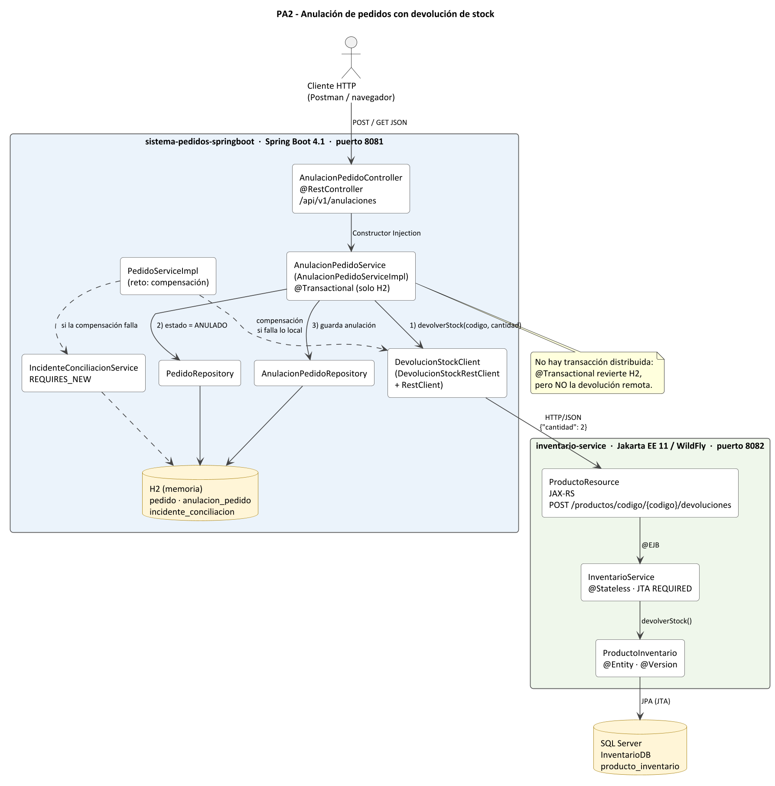

# Sistema de Pedidos — Spring Boot 4.1 (PA2)

Aplicación Spring Boot que registra pedidos en H2 y se integra por HTTP/JSON con `inventario-service` (Jakarta EE / WildFly). En la PA2 se agregó la **anulación de pedidos con devolución de stock**.



## Requisitos

- JDK 21 y Maven 3.9+ (o el wrapper `mvnw`).
- `inventario-service` ejecutándose en `http://localhost:8082` (ver su README).
- SQL Server con la base `InventarioDB` (la usa Inventario, no esta aplicación).

## Orden de arranque

1. **SQL Server** (servicio `MSSQLSERVER`).
2. **WildFly** → en `inventario-service`: `mvn clean wildfly:run`
3. **Spring Boot** → en esta carpeta: `mvn spring-boot:run`

Pantalla web: `http://localhost:8081/sistema-pedidos/pedidos` · Consola H2: `http://localhost:8081/sistema-pedidos/h2-console` (JDBC URL `jdbc:h2:mem:pedidosdb`).

## Endpoints

| Método | Ruta | Descripción |
|---|---|---|
| GET / POST | `/sistema-pedidos/pedidos` | Pantalla JSP y registro de pedidos (reserva stock en Inventario) |
| GET | `/sistema-pedidos/api/v1/orders` | Pedidos en JSON, ahora con `estado` (`REGISTRADO` / `ANULADO`) |
| POST | `/sistema-pedidos/api/v1/anulaciones` | Anula un pedido y devuelve su stock a Inventario |
| GET | `/sistema-pedidos/api/v1/anulaciones` | Lista las anulaciones registradas |

### POST /api/v1/anulaciones

```json
{ "pedidoId": 1, "motivo": "Solicitud del cliente" }
```

Respuesta `201 Created`:

```json
{
  "id": 1,
  "pedidoId": 1,
  "productoCodigo": "LAP-001",
  "cantidadDevuelta": 2,
  "motivo": "Solicitud del cliente",
  "fecha": "2026-10-15T10:30:00",
  "estadoPedido": "ANULADO"
}
```

| Caso | HTTP | Efecto |
|---|---|---|
| Anulación correcta | 201 | Inventario +cantidad; pedido `ANULADO`; registro en `anulacion_pedido` |
| Pedido ya anulado | 409 | No se llama a Inventario; no hay segundo registro |
| Pedido inexistente | 404 | No se llama a Inventario |
| `pedidoId` vacío / JSON inválido | 400 | Sin cambios |
| Inventario detenido o timeout | 503 | El pedido sigue `REGISTRADO` |
| Inventario rechaza la devolución (4xx) | 502 | El pedido sigue `REGISTRADO` |

Los errores devuelven `{ "status", "error", "message", "path", "timestamp" }`. Ejemplos listos en `requests/anulaciones.http`.

## Diseño

- `AnulacionPedidoController` → `AnulacionPedidoService` → `DevolucionStockClient` (HTTP) y `PedidoRepository` / `AnulacionPedidoRepository` (H2). Todas las dependencias llegan por **Constructor Injection**.
- `DevolucionStockRestClient` reutiliza el bean `inventarioHttpClient` (timeouts) y la URL `inventario.api.base-url`. **No reintenta el POST**: la devolución no es idempotente y un reintento podría sumar el stock dos veces.
- Orden en `anularPedido`: validaciones locales → devolución remota → escritura en H2. Los duplicados se detectan antes de la llamada remota y además `anulacion_pedido.pedido_id` es `UNIQUE`.

## Reto: compensación de la reserva

En `PedidoServiceImpl.registrarPedido`, si después de reservar stock falla la parte local (antes del commit de H2), se **compensa** llamando a la devolución (`10 → 8 → 10`) y se relanza la excepción para que H2 haga rollback (el pedido no queda guardado). Si la compensación también falla, `IncidenteConciliacionService` guarda un incidente `PENDIENTE_CONCILIACION` en una transacción propia (`REQUIRES_NEW`).

El fallo se simula **solo** con la propiedad `pedidos.simulacion.fallo-local-tras-reserva`, que es `false` por defecto (no hay endpoint ni parámetro HTTP para activarlo):

```bash
mvn spring-boot:run "-Dspring-boot.run.arguments=--pedidos.simulacion.fallo-local-tras-reserva=true"
```

`@Transactional` solo controla la conexión a H2; la reserva ya fue confirmada por otra transacción (JTA en WildFly) y otra base (SQL Server), por eso un rollback local no la deshace y hace falta la operación inversa.

## Configuración (`application.properties`, sin secretos)

```properties
server.port=8081
server.servlet.context-path=/sistema-pedidos
inventario.api.base-url=http://localhost:8082/inventario-service/api/inventario
inventario.api.connect-timeout-ms=2000
inventario.api.read-timeout-ms=3000
pedidos.simulacion.fallo-local-tras-reserva=false
```

H2 es en memoria (`create-drop`): los pedidos se pierden al detener la aplicación.

## Pruebas

```bash
mvn clean test
```

| Clase | Qué verifica |
|---|---|
| `AnulacionPedidoServiceImplTest` (Mockito) | anulación correcta, duplicada y fallo de Inventario |
| `PedidoServiceImplCompensacionTest` (Mockito) | compensación aplicada e incidente cuando la compensación falla |
| `ReservaCompensadaIntegrationTest` (Spring + H2) | stock 10 → 8 → 10 y el pedido no queda guardado |
| `PedidoServiceImplTest`, `SistemaPedidosSpringbootApplicationTests` | pruebas originales del proyecto |

Resultado: 11 pruebas, 0 fallos.

## Reproducir los escenarios

1. Ejecutar `../inventario-service/database/02_reset_stock_demo.sql` (LAP-001 = 10).
2. Registrar un pedido de 2 unidades de LAP-001 (stock → 8).
3. Ejecutar las peticiones de `requests/anulaciones.http` en orden: anulación correcta (stock → 10), duplicada (409), inexistente (404).
4. Detener WildFly, registrar o tener otro pedido y anularlo → 503, el pedido sigue `REGISTRADO`.

## Limitaciones

- No existe una transacción distribuida: si la devolución remota funciona pero luego falla el commit de H2, el stock queda devuelto y el pedido sigue `REGISTRADO`; se detectaría en una conciliación.
- La compensación del reto cubre fallos dentro del método; un fallo en el propio commit necesitaría `TransactionSynchronization` o un patrón *outbox*.
- Los incidentes de conciliación no tienen pantalla; se consultan en la consola H2 (`incidente_conciliacion`).
- H2 en memoria: los datos no sobreviven a un reinicio.
